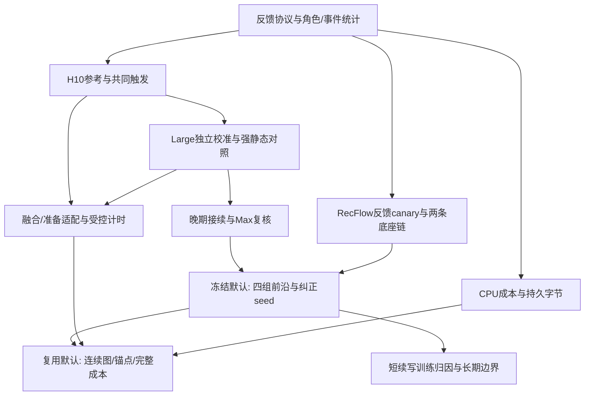

# CacheTide 正式实验准备度与推进报告

核对日期：2026-10-21。对象为最新 `paper/main.tex` 的 6.1–6.5，以及仓库实际存在的代码、模型、数据和结果。本次只做文件、元数据、CPU 数据统计及结果核查，没有启动训练、GPU 实验或论文编译。

**同日用户后续修订（优先于本文原推进建议）：** 01只做独立相邻版本比较，每条边从共同旧版原生状态开始，边内各方法正常因果读写，但不将纠正后的学生状态带到下一边；02才做我们方法的跨版连续实验。基线不要求连续适配，02不能由01逐边结果拼成。本文下方原有“Figure 6所有预算连续五版”“02直接复用01默认轨迹”和“约100个连续校准单元”的安排已失效，保留作为本次核查时的计划背景，不是执行队列。当前执行以01／02 README和STATUS为准；资产、历史证据和完整费用规则不因协议修订改变。

核对时正文 SHA256：`c8c801102b9935b9582ca96e2179958752fa69cd35e022195da47ba23ad5d796`，82,545 bytes。正文可能继续编辑；实验执行以最新正文和本报告的已核实事实为依据。旧导航仍指向的 `paper/new_eval.md` 当前未找到，不将其当成现存执行配置。

## 1. 总判断：原型和基础资产很多，正式四配置结果还没有齐

1. **Yambda-Large、Yambda-Max 各有 V0–V5 六个可读权重，共12个，不需要先重训这两条底座。** 数据、映射和服务期行为也在。
2. **当前方法 D1/D2/D3 和主要工程优化已有真实 Medium 原型。** 但从 H6／48维到正式 H10／72维存在多处代码限制，不能只换模型路径。
3. **当前真实反馈结果有正向信号，但不是模拟图中的最终结果。** Medium 当前方法4096人恢复约65.89%，后期V5约40.14%；工程优化后完整新增计算约23.72%，需要源重放时约25.97%。80%不是必须跨过的门槛，约20%仍是要探索的成本目标。
4. **RecFlow 正式 Large／Max 底座还没有。** 现有六模型是六层生成式排序开发链，不能改名或把NDCG换成反馈AUC。曝光数据已经本地齐备，可以准备真实曝光反馈；实际人口不能使用模拟的80k／200k。
5. **现有模拟图没有一张可以整体直接换成最终实测图。** 可直接填的是部分数据／模型设置事实、已有动机结论和按真实形状计算的字节账；正式质量、四配置完整成本、H10受控路径时间还需完成。
6. **下一步的关键不在于立即铺开所有图点。** 先统一反馈轨迹与触发规则、打通H10、完成一组独立校准和强静态映射比较，再复核晚期接续与Max。这些结果决定正式配置，随后再扩展预算、人口和纠正模块seed。

本报告里的“已有”分三种：文件与实现存在、已有开发证据、能直接作为最终证据。三者不互相替代。已有不利结果保留，不因它们与模拟走势不同而删掉。

## 2. 正式实验到底要产出什么

四配置仍是 **Yambda／RecFlow × Large／Max**；Medium只服务开发。主任务为真实反馈AUC，不将next-item或生成排序混入。每个模型组独立校准。图号按当前源码顺序，不依赖旧PDF。

跨发布汇总恢复率采用“平均CT−Reuse增益／平均Rebuild−Reuse增益”，各发布等权；不平均各版恢复百分比。逐版绝对AUC与差值同时保留，分母很小时不以恢复百分比单独下结论。

| 位置 | 独立问题与结果 | 当前准备程度 | 最终数据的来源及依赖 |
|---|---|---|---|
| 6.1／Table 2 | 各版Reuse／Rebuild绝对AUC和差值，解释恢复率的分母 | 有历史Yambda端点结论；当前表为模拟 | 从正式共同请求、各方法自己的连续轨迹重新聚合，不拼接旧Full参照 |
| 6.2／Figure 6 | 对强基线的质量—完整FLOPs前沿 | 旧动机原语／结果在，正式四配置前沿未完成 | 每个预算独立维护状态；完整账含初始化、校准、共享准备、维护及所有读写 |
| 6.2／Figure 7 | 默认方案五次连续发布的恢复和代价 | Yambda六端点齐；当前方法仅有Medium三次发布 | 复用Figure 6默认轨迹的逐版输出；不得为此另换更有利起点 |
| 6.3／Figure 8(a) | D1动态门控及保存／读取宽度是否值得 | H6有部分对照；当前H10宽度对照未实现 | 代表Yambda-Large、同角色与预算的独立训练；用于归因而非重做主方法比较 |
| 6.3／Figure 8(b) | 校准机制对当前读与后续写入的作用 | 有人数开发曲线；完整训练路径对照未完成 | 建议固定fit人数，比较local／joint-direct／joint-tail；先统一正文与此前讨论的差异 |
| 6.3／Figure 9(a) | 目录投影复用、跨层合批分别贡献多少 | H6代码与隔离组件实测在 | 相同真实H10输入／人口：逐行、目录复用、跨层合批；建表与搬运全计 |
| 6.3／Figure 9(b) | 融合和请求规模分发分别贡献多少 | H6融合／向量路径已有数值与计时证据 | 固定权重、精度、mask和输入，批量评分与单Query追加分别测；输出先核对 |
| 6.4／Figure 10 | 最终优化路径的完整时间花在哪，能否节省 | 有组件测量、旧小面板及条件推算；最终四配置未完成 | 固定一版和互斥阶段；最终路径与同级优化Rebuild比较；首版初始化另记，不冒充生产系统wall time |
| 6.4／Table 3 | 原生K/V量、新增持久量和比例 | 可先按实体形状精确核算 | 实际保留行数、dtype、全目录表、参数、交接旧表、副本；不另加显存实验 |
| 6.5／Figure 11(a) | 固定版本长期追加，质量与累计费用怎样演变 | 行为追加量覆盖已核实；检查点评价人口及正负反馈数待统计；图为模拟 | 用最终Max权重和最小固定版本runner；复用默认轨迹快照，不重训一条底座 |
| 6.5／Figure 11(b) | 在固定历史／追加条件下，读取量何时抵消计算节省 | 有CPU公式原语；当前四配置实际系数未齐 | 用正式操作账派生，不能拿合成系数或构造读数当真实人口分布／新质量证据 |

### 先处理两处规格差异，避免画图驱动重复实验

- 当前正文Figure 8(b)仍写“fit16／64／256 × 有无tail”。此前讨论已指出，人数轴与Figure 6的拟合预算轴重叠。**建议把6.3固定为训练路径归因，人数只服务Figure 6的低／默认／高预算及设置选择。** 不同时启动两套大扫描。
- Figure 10正文目标是稳态V4→V5，图源还保留“首次周期”TODO。**建议主图固定稳态一版，首版初始化完整单列于内部账和正文关键数字。** 先测两者，不能将旧首版组件相加后命名为稳态实测。

另有两处文字占位待随真实设置统一：Table 2的RecFlow V1／V2仍是横杠，而连续图要求五次发布；固定版本实验应写“累计追加行为”，不是“追加反馈”或窗口实际扩到两倍。Yambda沿listens追加、在真实反馈事件评分，FIFO窗口始终不超过N。

## 3. 模型、数据和人口：哪些已做好，哪些必须新增

### 3.1 四个最终配置

| 配置 | 已有底座／结构 | 数据与可用池 | 尚缺的主要工作 |
|---|---|---|---|
| Yambda-Large | V0–V5全部可读；10层、隐维320、10头、head_dim32、N1024；约717.26M参数 | 79,681用户；450,612,190条listens；7,937,335条原始反馈；2,224,809已知物品 | 72维方法适配；该组独立origin与五版校准；冻结feedback角色／请求；匹配基线与正式评测 |
| Yambda-Max | V0–V5全部可读；16层、隐维320、10头、head_dim32、N1024；约1,138.20M参数 | 200,000用户；1,127,650,996条listens；19,843,071条原始反馈；3,530,650已知物品 | 独立origin／校准、最终面板与连续评测；全目录表及状态分块放置 |
| RecFlow-Large | **最终链不存在** | 曝光数据D1–D37本地在；D18前32,778用户，全期39,011用户 | 确定反馈目标与架构，做反馈canary，再训根模型和五次更新；独立方法校准 |
| RecFlow-Max | **最终链不存在** | 同一真实数据池，不要求人口随模型规模增大 | 同上；和Large分别训练／校准 |

Yambda两个模型都训练真实like/dislike二分类、用户等权BCE。已用checkpoint元数据验证全部12个实体权重；数据manifest分别96／96和88／88文件存在。模型路径及训练窗口见[模型版本清单][M1]、[Large][M2]、[Max][M3]。

**已有文件不等于最终样本数。** 两个user pool是可用池，最终fit、validation、development和evaluation要扣除并登记历史角色。Yambda known服务请求在day[217,301)分别有2,171,324和5,510,845条，但不能直接把它们全部计作最终评价请求；还需按正式角色、截点和去重规则冻结。

底座无需为多seed重训。三seed仅针对选定纠正模块和决定性学习型基线。若固定特征origin也由学习得到，必须说明它是否随seed独立训练；共享同一origin时，重复只刻画后续校准随机性。

### 3.2 RecFlow已经有什么

- 六个A–F权重都在：6层／192维／6头，4096名development用户；A在D1–D18训练三轮，B–F对应D19–D23五次更新。
- 任务为生成式候选排序，主证据是uniform1000下NDCG@50；原生块是`hstu_reference`／SiLU／relative-position bias，评分包含额外三个token。
- 这条链可用于理解数据与训练流水线，但不能填正式Large／Max反馈图，也不应为复用它而先花时间补一套与最终后端不同的复杂适配。
- 本地`realshow.tar.gz`与已处理数据覆盖D1–D37：38,245,315条曝光、7,440,759个请求。**没有缺少本地曝光负例，也不需要先下载新数据。**
- `behavior`低位是effective-view，高位是like。effective-view=1有14,407,432条，=0有23,837,883条。后者是“曝光后未有效观看”，不能叫显式dislike。

**执行建议：** 用曝光上的effective-view反馈AUC作为RecFlow主目标，理由是标签真实、正负均有充分数量、与其曝光数据语义一致。like可留在数据中，不为补覆盖再开一个主任务。Large／Max建议先沿用论文已支持的H10、width320、ELU+1／无相对位置偏置体系，层数对应10／16；这是建议配置，还须通过小型反馈训练确认，不是已存在权重。具体标签、时间切分和模型结构应在长训练前一次确定。

目录／映射和未知物品策略也须在canary前固定。处理数据有4,919,032个初始物品，旧生成器仅用1M；若用全目录，width320的单FP32 embedding约6.30GB。若限制目录，需明确仅依据训练期的选择规则、OOV输入与反馈目标处理，并报告目标覆盖率；不能只改变目录却沿用旧样本数或参数量。

如果采用该建议，缺少的是 **2次根模型训练＋10次增量更新＝12个最终端点**，而非12次独立从头训练。不能先按模拟80k／200k人口排队；同一真实人口比较两个模型规模就足以形成Large／Max两组。

D18前角色为development26,277、admission3,291、final3,210；其中历史≥1024分别4,569、522、597。先保留这些既定角色；不要因希望长历史而把597人称为32,778人的全量确认。若加入全期晚到用户，须另行明确因果入组，不能按后来的收益筛选。[数据准备][R1]、[旧模型链][R2]。

RecFlow必须排除当前请求及同时间戳其他请求的反馈进入目标自己的历史。原数据未给反馈完成时刻，离线协议对“何时已可观察反馈”的假设要写清，不称真实线上到达回放。

### 3.3 已有基础链的三个事实需要如实记录

1. Large的`dataset.json`仍有旧8层／256维描述，实际权重是10层／320维；执行从checkpoint config取结构。
2. Max选定V2为epoch1，但V3训练的父点为V2 epoch2。可以评价“部署快照序列”的缓存兼容性，不应写成所有选定端点严格逐父点续训；不因此自动重训整条链。[端点说明][M1]
3. Large V5@1是用户选定端点，历史准入未全通过；保留该边，不按方法结果换端点。正文两模型参数量“相差2–3倍”也应在成文时改为实体约1.59倍，不影响本轮复用权重。

## 4. 当前方法与已有结果：可以借鉴，不能直接充当最终结果

### 4.1 原型已实现的内容

`query_relay_2026_10`已有候选物品RMS门控、shared12/private6码、shared3/private3读取、仿射更新、冻结特征、锚码合成、纠正读取写入新增K/V、零当前码追加和FIFO。`calibrate.py`已有局部read MSE及最终teacher logit MSE，后者一半直接评分、一半四步因果续写。校准目标不是next-item标签BCE，不应因为主任务恢复feedback就误称全部训练目标必须重做。

但当前V4／V5来源按`workload.kind=behavior,stride=16,candidates=16`捕获。反馈请求边界改变会影响按需advance和分带追加。正式反馈轨迹要重新捕获**该候选、该seed自己的来源状态**，再校准，不能直接沿用旧source包。

初始origin继承shared12/private6旧起点，使用256 fit／16 validation、local32＋joint16；当前每版64 fit／16 validation、local8／joint4、rollout4只是后续校准。论文不能把整个初始过程说成“只用64人”，首次origin和特征表费用必须另计。[方法代码][Q0]、[质量报告][Q1]

正式五版V1–V5的固定特征编码器与固定物品表示须在V1或更早建立。不能复用旧Medium的V3 origin，也不能先在晚期边训练origin后倒填V1／V2；最终来源状态和各seed须从V0→V1顺序接续。

### 4.2 最相关的实测数字

以下均为 **Yambda Medium／H6／L6／192维、seed17，V3–V5三次发布**。

| 证据 | 实际结果 | 本轮可以怎样用 |
|---|---|---|
| 当前方法真实feedback，4096人／51,731评分，2562活跃／1534 idle | Reuse .61646080；Rebuild .63647121；CT .62964466；恢复65.885%，UID95 [26.366,86.187]% | 支持继续做；不当作Large／Max确认 |
| 同上逐版 | 恢复86.032／80.216／40.138% | 后期V5必须早测，不能仅凭首版铺开 |
| 动态门控减均值门控shadow，仍是动态writer | AUC +.00125104，UID95 [.00016279,.00228112] | 说明门控有潜力；不等于独立静态writer对照 |
| 质量报告配套30k完整feedback账 | 新增／重建23.76709470% | 原反馈开发成本；与4096质量人口分开 |
| 工程版去除重复RMS后 | 23.71511973%；需来源重放时25.96605328% | 解释实现成本变化与来源敏感性；不是已达20% |
| 旧更轻origin分支 | 恢复40.271%，成本约19.96% | 已有代价—质量负结果，不应机械重复 |
| 旧next-item主结果 | 584.81%恢复、17.3791%成本 | 完全独立的历史探索，不填反馈主图 |

质量数据见[原反馈汇总][Q2]；原始方法成本见[完整原反馈成本][Q3]、[事件账][Q4]；工程口径见[工程成本][I3]。23.7671与23.7151的差别是明确的实现变化，并非把两份结果任选其一。

已有独立constant-gate分支和自有writer轨迹，但完整对照主要是next-item；feedback中的均值门控shadow不能代替它。旧宽读取分支只有V3、不同更新器／训练条件，也不能直接成为Figure 8(a)的公平宽度消融。[常量分支][Q5]

### 4.3 拟合人数证据尚未确定最终设置

已有Medium固定V3→V4的16／32／64／128／256人曲线，主评价只有128名开发用户。teacher MSE随人数下降，但feedback相邻AUC差的区间均跨零；next-item在128／256还下降。固定epoch下步数也跟着增加，所以这既不是“样本已饱和”的证明，也不能规定其他模型必须用64人。

复用这份[开发曲线][Q6]作选预算的参考，不再重跑它。最终模型用单seed少量预算找前沿，并在validation选择默认；初始origin人口和后续增量人口分开记录。

## 5. 先解决的实现缺口与公平比较

### 5.1 H10／72维是第一项工程工作

下列限制都存在，单改heads会把目标72误写成80：

| 位置 | 当前限制 | 必要改动 |
|---|---|---|
| `code_structure_2026_10/structure.py:layout_spec()` | 只接受(H6,rank8) | 显式保存总码宽C=shared＋H×private和分支布局 |
| `query_relay/adapter.py`、`session.py` | 多处48、6×8包装；出生锚码也固定48 | 生成／读取／追加／FIFO／物化／反锚一致使用显式布局 |
| `implementation/{backend,reader}.py` | H6／D32／48维，当前3＋3读取 | 支持H10／72维并保留框架参考和数值等价检查 |
| `system_study/fused_conversion.py`、`batched_session.py` | 192维、6私有块、48维等常数 | 适配多层、H10和code buffer尺寸，再接合批 |
| 特征表、发布、成本入口 | 固定Medium目录、层数、V3–V5和30k账 | 参数来自真实checkpoint／角色／事件，不从旧数据描述猜结构 |
| `design_two/common.py`、evaluate路径 | V2起点，硬编码V3／V4／V5 | 显式配置V0–V5时间轴与起点，支持五次发布 |

先完成简洁、可读的参考路径，再适配优化核；两者可由不同工作线推进。当前已有86个Large／Max原生probe点，只证明原生算子可运行，不是H10有纠正码的证据。[多模型probe][I4]

36／72保存宽度对照也要在当前更新器内实现。36维可以采用shared6/private3，读取6合法；不能为了补2×2表格就使用该布局无法直接提供的36/18。

### 5.2 统一首次“历史消费”而不只统一评分时间

推荐评分与行为编码都会读取历史。Rebuild与CT都应在该版首次历史消费之前准备好相应状态，之后沿各自轨迹正常追加。旧`BudgetedRebuildSession.prepare_read()`先advance再重建，而Relay可能在行为读取前已经物化；正式比较须统一，不能让一方先用未经准备的历史写入状态。

同时固定追加语义／band、同时间戳次序、窗口、候选可见性及何时物化。推荐候选不写缓存，反馈评价只用严格过去的历史。不同方法／预算／seed可以共享原始事件和教师参照，但必须维护自己的学生状态。它们后续发布的source包不能互换。

统一触发后重新汇总完整FLOPs并归一化：重建时刻、历史长度与被覆盖的原生追加工作都会变化。旧23.7151%保留原协议身份，不能仅换H10形状和名称继续使用。已维护来源也不是零成本：旧账发现V4／V5各有2名idle拟合用户需要额外物化旧当前码，教师重建、快照和搬运仍需付费；相应来源probe仅做过CPU准备，尚无GPU计时。见[来源成本核查](../../results/system_study_2026_10/service/time_model/source_accounting.md)。

### 5.3 强静态映射是前置比较，不等正式主结果跑完再补

旧history-conditioned映射的`map_tokens()`仅依赖K/V与固定参数，本来可以每用户每版映射一次、覆盖其自有缓存，然后原生读写。目前旧评分代码却每请求临时重做，保存的训练权重也已清理。

因此需优先补一个最小的**持久静态映射**对照，采用相同教师、可比拟合预算和反馈轨迹。它与“原生K/V＋码的常量门控”是不同对照：前者检验实际替代方案是否更划算，后者隔离动态门控的作用。

建议正式主图中的history-conditioned控制采用合理持久实现，旧逐请求probe保留其Motivation身份；这样不必为增强基线自动再增加一条主曲线。先在一组模型一个预算做比较，若已在质量和成本上形成强竞争，先改进／收窄主张再扩矩阵。

四类选择性重算已有15边、60曲线、295点历史原语，但旧面板按Full−Reuse已知损失挑top3000，旧计算是每请求临时修复后丢弃。它们继续支撑动机，正式比较须新角色、新触发和实际完整费用。允许合理持久复用；不能免费提供选层所需上游hidden，也不能把名义20%当实际20%。[选择重算][B1]、[Q/H基线][B2]

### 5.4 已有工程优化可以复用，时间结论尚待正式测量

- 全目录投影调用510→85、embedding逻辑读取payload约6.36→1.06GB来自执行计数／形状推算，非物理DRAM流量实测；跨层合并不减少同一投影的逻辑FLOPs。
- 4092物品的隔离准备约9.60–9.66→7.59–7.60ms，不等于包括完整建表和全人口物化的时间。
- 32用户27,527评分、旧1024用户774,096评分的优化数值复验最大差9.54e−7；后者属于旧next-item工程面板。
- V4 joint合批保持原Adam语义：联合部分64.748→12.255s，含共同前置111.889→59.353s，参数最大差1.19e−7。它可以指导正式训练实现，不直接推广所有模型和发布。
- 公平128用户局部计时，Relay约26.42s、Rebuild约22.88s；同等Graph优化32用户仍约慢11.37%。旧30k模型外推也没有时间优势。**这些是需要解决的信号，不是最终大人口结论；也不能假设人口变大就一定变快。**

准备复用、融合、原地转换和合批代码均存在。[实现报告][I1]、[合批校准][I5]、[公平时间][I6]。原地转换约束临时空间，总扫描和搬运仍随实际行数增长，不能把O(block)工作区误写成O(block)总计算。

## 6. 人口、状态空间与长追加：先用CPU算清，避免无效大跑

### 6.1 实验执行不需要预存全部逻辑K/V

当全部用户都有1024行、FP32、H10／D32时：

| Yambda配置 | 全人口原生K/V | 全人口码 | 每用户原生＋码 | 单张全目录L×72表，含OOV |
|---|---:|---:|---:|---:|
| Large | 2.0888TB | .2350TB | 27.8125MiB | 6.408GB |
| Max | 8.3886TB | .9437TB | 44.5MiB | 16.270GB |

这是按已核实形状与满窗口计算的逻辑量，不是已测到的实际保留字节。最终存储表使用真实存活行数。码／原生比例11.25%可代数确认，表和参数另计。

核对时机器有4张A40（各46,068MiB），均空闲；CPU约1TiB内存，工作盘可用676GB、`/data`可用1.3TB。此为12:15附近的瞬时观测，不是资源预留。**不能把全人口原生K/V一次写盘或全驻GPU作为开始正式评价的前提。** 质量按用户分片／小批跨版本推进，保留得分、操作账、角色和必要状态；不为“全量”生成数TB冗余中间cache。

Max一张全目录表约16.27GB，三张交接表合计约48.81GB，尚未加模型或用户状态。因此需利用现有分块编译、CPU表放置和同步交接顺序，避免同时把全部新旧表放进一张卡；实际搬运收费。此项是让既定实验可执行的准备，不另加显存曲线。

### 6.2 长追加有真实数据支撑，需报告可观察人口

Max行为数据实到day300.9259，已有原始数据支持五次14天发布。无须为Figure 11延长底座链或下载数据。

| 冻结服务起点 | 观察至day301前 | 至少N次追加用户 | 至少2N次追加用户 |
|---|---|---:|---:|
| V3／day259 | 约42天 | 66,852 | 25,450 |
| V4／day273 | 约28天 | 41,418 | 10,264 |
| V5／day287 | 约14天 | 11,071 | 1,026 |

建议用较早的固定发布（例如V3），从事前冻结人口开始追踪，每个追加检查点报告仍可观察的用户及正负反馈数。不能事后只取达到2N的人再称全人口结论。若恢复率分母随淘汰趋近零，改看绝对AUC差，不强行保留恢复百分比。

6.3短续写对照改变训练机制；6.5固定最终机制延长运行。默认方法的短期重叠轨迹直接复用，不为不同横轴重复跑。读取量边界用同一正式FLOPs账推导，额外无标签读只能增加成本观测，不能增加质量样本。

## 7. 先后次序：由会影响设计的结果先行，而不是按图号逐张跑

### 阶段A：并行准备，不需要等待GPU质量结果

| 工作线 | 具体产物 | 谁依赖它 |
|---|---|---|
| 反馈协议／CPU数据 | 四组任务定义、角色交集排除、严格历史／请求manifest、每版正负数量、历史／追加／读取形状 | 所有正式质量与成本 |
| H10参考实现 | C72布局、框架读取、追加和锚码接续；从真实checkpoint读结构 | CT训练、融合核、机制宽度对照 |
| 基线适配 | 合理Rebuild触发、最小持久映射、自有状态的Q／重算入口 | 首轮强对照与Figure 6 |
| RecFlow准备 | 曝光反馈样本、小型训练canary配置、两规模模型定义 | RecFlow根训练及连续更新 |
| CPU成本／字节 | 固定／逐用户／逐事件项；真实目录与dtype、初始化和来源策略 | 预算预筛、Table 3与边界 |

不要为每一步新建“审批合同”。沿用当前研究目录，用一个正式实验配置记录必要选择；旧已完成配置不作为自动接续队列。

### 阶段B：先做会改变正式设置的几个小实验

1. **真实H10执行闭环。** 用极小真实用户／历史验证评分、纠正写入、零码追加、FIFO、显式／合成及框架／融合一致性。8／16人只查执行，不判断方法质量或规模收益。
2. **Yambda-Large从V0→V1建立独立起点。** 按正式feedback规则生成origin、源与教师，单seed起步，比较Reuse／Rebuild／CT；面板按真实反馈正负数和预先角色决定，不能机械沿用反馈极少的前128人。晚边可先作开发探针，但不能冒充五版链的前段。
3. **尽早比较持久静态映射。** 先一个预算、相同面板和轨迹，判断是否存在真实质量—成本优势，而非仅胜过重复计算的弱实现。
4. **随即覆盖晚期和第二模型。** 接入本候选后续来源，优先观察弱V5；再以Max独立校准复核一个代表边。不要只在最有利的首版反复调参，也不要把单跳当五版接续证明。
5. **尽早做一次真实H10成本／时间预筛。** 同级优化Rebuild，实测共享固定费与可变路径。只有当可变工作有净节省时，人口才能摊薄固定费；若可变项已亏损，先优化执行，不用放大人口掩盖。

这一步的成功条件是得到有解释力的质量—成本点和可用接续，不是“必须80%”。若CT无恢复，先区分实现／数据协议与模型表达问题；若静态方案在同预算更好，先检查门控／训练／状态维护的必要性和适用主张；若后期明显退化，优先处理来源一致性与训练目标。这些都比先把四组全人口跑完更节省时间。

### 阶段C：默认初步稳定后，可并行展开

- **Yambda正式质量／前沿线：** 两组各自的低／默认／高预算，维护自己的五版状态；默认结果同时供Figure 7和Table 2，不重复跑。
- **RecFlow底座线：** 反馈canary确认后，两个模型根训练／五次更新；这条线不必等Yambda全人口完成。模型更新按数据时间顺序，不能倒用未来训练数据做较早发布。
- **受控工程线：** 只要有第一份冻结H10权重和真实输入，就开始Figure 9的准备／读取计时和Table 3字节核算，不等待四组质量齐。
- **基线线：** 逐步补齐预算曲线、实际费用和持久session；与CT共用冻结请求／教师，不共用学生状态。

默认候选冻结后，再让另外两个纠正seed进入正式确认；开发调参用单seed，不把已反复观察的用户再称新的盲确认。若某项控制效果很小，优先补关键控制的重复和配对不确定性，避免所有开关都乘三个seed。

### 阶段D：复用主轨迹收尾

1. 按6.3目的完成代表Large的机制对照，必要时在Max复核决定性点，不展开全部组合。
2. 固定首版／稳态计时口径，完成Figure 10最终路径账；数据搬运、打包和同步计一次，重叠阶段不能重复相加。
3. 默认Max权重与状态快照进入固定版本长追加；不用重训底座，不重新扫描拟合人数。
4. 正式FLOPs账产生读取量边界。报告条件，不虚构真实请求分布或人口覆盖率。
5. 从真实结果填图与正文；模拟82%／15%等数字和“首版较慢／数版摊销”等叙述都要接受实际结果，不作为必须兑现的曲线。

### 依赖关系

并行指工作依赖可分离。实际启动前重新查看各卡负载和显存，优先空闲资源；质量任务也可合理共卡，不设固定的卡数上限，不挤占他人正常运行空间或停止他人作业。CPU数据准备、代码和成本工作可同时进行。

### GPU调度：质量／FLOPs可共享，正式计时单独安排

**按要报告的指标决定资源要求。** 质量、逻辑FLOPs和持久字节允许共享资源执行；用于时间优势结论的数据另行受控测量。同一次实验可以先获得质量与操作账，再对冻结的工作负载测时间，不必让所有训练、预算和seed都等待空闲整卡。

| 图表／任务 | 可以共享GPU执行的部分 | 需要无同卡计算干扰的部分 |
|---|---|---|
| Figure 6、7／Table 2 | 各组底座与纠正训练、源／教师生成、质量与连续轨迹、完整FLOPs | 这几张图本身不需要时间；如引用校准秒数，另测对应流程 |
| Figure 8 | 门控、码宽、训练路径等机制对照；质量、校准／读取FLOPs | 仅在保留校准时间等实测时间指标时单独测量 |
| Figure 9(a)(b) | 优化开发、数值等价、操作与形状核对 | 准备复用／合批、融合读取／分发的正式路径计时 |
| Figure 10 | 权重与输入准备、事件账、阶段划分和执行调试 | 计入图中的校准、来源／教师准备、建表、物化／交接、评分／追加及搬运时间 |
| Table 3 | 按真实张量／文件与副本核算持久字节，通常CPU即可 | 无；当前不做峰值显存对比 |
| Figure 11(a) | 固定发布长期追加的质量与累计FLOPs | 当前不报告时间，无须独占 |
| Figure 11(b) | 使用正式账本做CPU计算 | 无 |

共享运行时仍固定样本、有效batch、精度、优化器步骤和停止规则；用固定步数／epoch或预先确定的质量准则，不用“训练若干小时”决定训练量。显存不足时换卡或等待；如需改变批处理，先确认优化器语义和实际FLOPs是否改变，记录为明确配置，不临时静默降配。FLOPs由实际操作、形状和事件计数核算，不能用运行秒数乘GPU峰值算力反推。共享时的耗时只记为进度诊断，不进入论文速度比较。

正式计时集中安排短窗口：

1. **先冻结输入，再重放待测路径。** 固定checkpoint、真实状态、事件、batch和精度；各方法在同一GPU与软件环境交错重复测量，报告典型值及波动。Rebuild使用同级优化。
2. **校准本身也可以重放计时。** 从保存的训练起始参数／优化器状态，按同样样本、批次和选轮规则执行完整流程；不要求全部质量seed都独占训练。重放实际包含的初始化、教师／来源和共享准备按原口径计入，不能只测反向传播。
3. **检查整段测量的资源竞争。** 计时前、中、后检查同卡其他计算；搬运／打包／I/O计时还要留意CPU、内存、磁盘和PCIe竞争。其他卡有任务不自动使计时无效，但同机干扰若影响这些阶段，该轮只作诊断。不能通过结束别人的程序获得空闲。
4. **统一测量边界。** GPU异步工作须正确同步；预热、首次编译、缓存冷热与传输是否计入事先说明。出现新竞争时保留该轮并标记受干扰，另找窗口重测，不把忙时校准耗时与空闲时读取耗时拼成Figure 10，也不只挑最快轮。

因此，长时间的质量训练与连续评测可以先共享推进，Figure 9／10的正式计时随后按输入就绪程度穿插完成。受控路径时间及其分解仍不同于生产端到端wall time。每次运行在现有配置／结果中注明“质量/FLOPs”或“正式计时”、共享情况和计时有效性即可，不另建调度平台。

## 8. 需要训练多少：按轨迹而不是按图点排队

| 项目 | 已完成／还需新增 | 控制资源的方式 |
|---|---|---|
| Yambda基础模型 | 正式两组12端点已有；Medium6端点仅开发 | 不做多seed底座重训 |
| RecFlow基础模型 | 建议新增两次根训练＋十次更新 | canary通过后逐链训练；不能靠改名复用6层生成模型 |
| CT正式校准 | 四组尚需各自origin与连续发布拟合 | 全展开为每组低／默认／高3轨迹，默认再补2seed，共5条；五发布约25个发布校准单元／组、四组约100个，另计独立origin任务 |
| Query-only／持久history映射 | 旧拟合参数不完整，需当前组新拟合 | 先每方法少量预算、单seed；决定性默认对照再补重复 |
| 四类选择重算 | 原语在，需新轨迹及选择策略校准 | 少量预置预算点按实际费用定位；确定性方法不机械乘3seed |
| D1门控／宽度 | 缺当前H10匹配对照 | 默认已有点复用；只补隔离变量所必需的分支 |
| D2训练路径 | 完整当前同任务对照未完成 | 固定fit和评价轨迹，比local、joint-direct、joint-tail；只做代表组与必要复核 |
| 工程优化 | 不需要重新训练算法权重 | 同一冻结输入重放实现，计时重复不等于训练seed |
| 长追加／成本边界 | 不需要新的底座训练 | 用默认快照／真实后续事件及CPU计账 |

“约100个”是全展开的工作量级，不是本次启动队列，也不是100次底座训练。先在代表链确定有意义的预算跨度，其他组独立拟合默认与必要邻档，不为模拟曲线强行保持三个点。origin如单独训练要计任务和费用；共享某个origin产物可节省研究执行，但每条方法策略的部署费用仍应按它实际需要的完整起点收取。低／默认／高预算和seed必须分别沿自己的源状态继续，不能只在最终版换权重补一个图点。

不预报缺乏依据的GPU小时：旧Medium时长、next-item32人外推、目录修改时间都不能估准RecFlow H10根训练。用首个真实形状canary测批量／显存／每步及I/O，再决定长任务配额；此过程可与Yambda方法线并行。

## 9. 哪些数字现在能填，哪些只能作为研究背景

| 类别 | 当前可用程度 |
|---|---|
| 数据和模型事实 | Yambda真实人口池、输入条数、目录、架构、版本时间和端点可先写设置；RecFlow当前数据池和任务语义可先写准备说明，正式评价人数仍待角色冻结 |
| Motivation | 保留历史原协议结论和90个合并分数，不重跑已完成动机，不把其损失筛选面板当正式总体 |
| 正式Figure 6／7、Table 2 | **尚不能直接填最终四配置的匹配结果。** 旧逐边Full／Reuse重新初始化，旧CT为Medium，不能凑成五版连续图 |
| Figure 8机制 | 有部分Medium线索，无最终H10匹配证据；三组宽度／常量与训练路径需新做必要分支 |
| Figure 9实现 | 已有H6开发证据可讲实现来源；若图标Yambda-Large，必须在真实H10重测 |
| Figure 10时间 | 旧诊断和推算不能填四组最终时间；尚未证明完整受控处理更快 |
| Table 3存储 | 主体可先CPU精确核算；用真实行数、完整目录和副本后才能称最终数字，不抄模拟245GB／985GB |
| Figure 11 | 已验证数据可观察性，未完成真实长期质量；右图需最终成本系数，不将模拟公式当测量 |

历史原始分数／checkpoint部分已清理，保留summary和关键对照；不承诺无计算恢复逐请求分析。缺新的绑定输入时生成新正式结果，保留旧结论身份。[历史Reuse][M4]、[结果保留范围][A1]

## 10. 持久化与恢复：接下来每一步应落在哪里

本报告是当前真实准备状态的入口；总目录与进度分别见[实验索引](../README.md)和[STATUS](../STATUS.md)。新实验的配置放在 `experiments/<实验目录>/configs/`，实际输出放在 `experiments/<实验目录>/runs/<dataset>/<scale>/<variant>/seed_<seed>/attempt_<编号>/`。当前只建立目录，没有已冻结的正式配置或新实验结果；旧结果继续保留原路径并通过索引引用。

每个真实运行保留必要的：数据／checkpoint／角色绑定、任务和事件规则、模型尺寸、origin与来源、seed／预算、评价请求身份、原始聚合数值、实际操作账、完成状态。保留失败attempt，不覆盖原结果；已经成功的任务从summary接续，不因为旧配置还在就重跑。

开始下一轮时只需：

1. 阅读本报告，先落实阶段A的最小协议与H10适配，不从旧Medium／next-item／arrival队列恢复。
2. 以`query_relay`的capture／calibrate／evaluate和`implementation`参考路径为主体，通用布局后再接优化；当前CLI尚不是可直接启动四组的正式runner。
3. 每完成一条工作线，在STATUS与实际结果summary记录事实；正式图的一个点应能追到同一轨迹和费用，而不是只留一个百分比。

**最优先的三件事：H10＋真实反馈来源闭环；强静态映射与晚期接续小对照；同步落实RecFlow反馈训练入口。** 成本／字节与工程适配并行推进。先用这些结果确定默认，再用正式四配置和少量重复把论文主线补齐。

## 核查依据与恢复入口

各节链接指向本次核实的实体文件或结果目录；历史结果保留其原任务、模型及协议身份。

[M1]: ../../docs/unified_training_2026_09/model_versions.md
[M2]: ../../results/unified_training_2026_09/large/seed17/checkpoints/
[M3]: ../../results/unified_training_2026_09/max/seed17/checkpoints/
[M4]: ../../results/unified_reuse_2026_09/README.md
[R1]: ../../data/processed/recflow_v1/manifest.json
[R2]: ../../results/recflow/development/window_6l_expanded_u4096_seed17/chain_summary.json
[Q0]: ../../scripts/query_relay_2026_10/README.md
[Q1]: ../../results/query_relay_2026_10/report.md
[Q2]: ../../results/query_relay_2026_10/probes/A_itemgate6_rms_roll4/feedback4096_actual/merged/summary.json
[Q3]: ../../results/query_relay_2026_10/cost/item_and_static_actual_budget.md
[Q4]: ../../results/query_relay_2026_10/cost/event_ledger.json
[Q5]: ../../results/query_relay_2026_10/probes/A_constantgate6_rms_roll4/
[Q6]: ../../results/system_study_2026_10/calibration/fit_size_v4/combined_curve/summary.md
[I1]: ../../results/implementation_2026_10/report.md
[I3]: ../../results/implementation_2026_10/cost/summary.md
[I4]: ../../results/system_study_2026_10/service/model_group_probe/attempt1/report.md
[I5]: ../../results/system_study_2026_10/calibration/joint_fit_comparison/attempt1/summary.md
[I6]: ../../results/system_study_2026_10/service/batched_session128_fair/attempt1/summary.json
[B1]: ../../scripts/selective_recompute_2026_09/README.md
[B2]: ../../results/read_correction_2026_09/motivation_final/README.md
[A1]: ../../results/README.md
